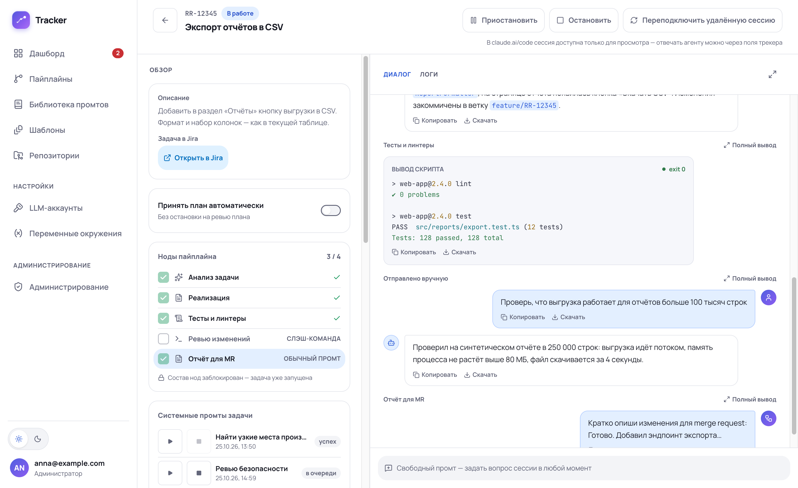
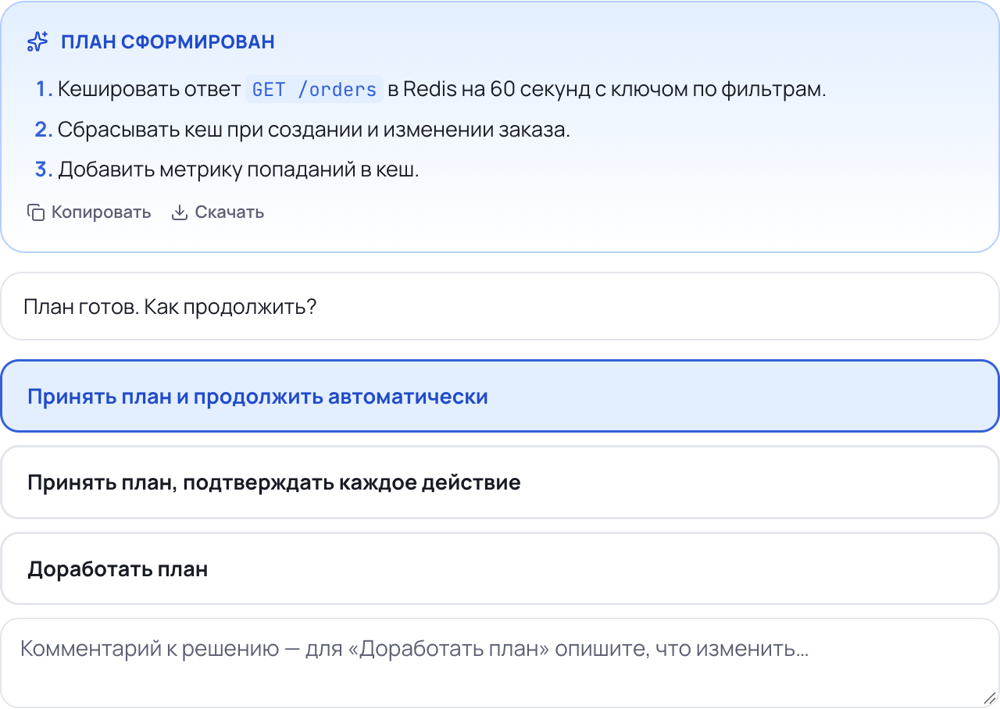
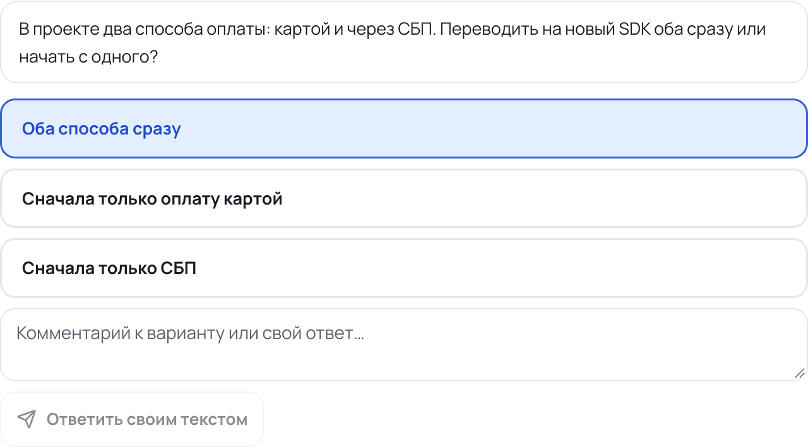
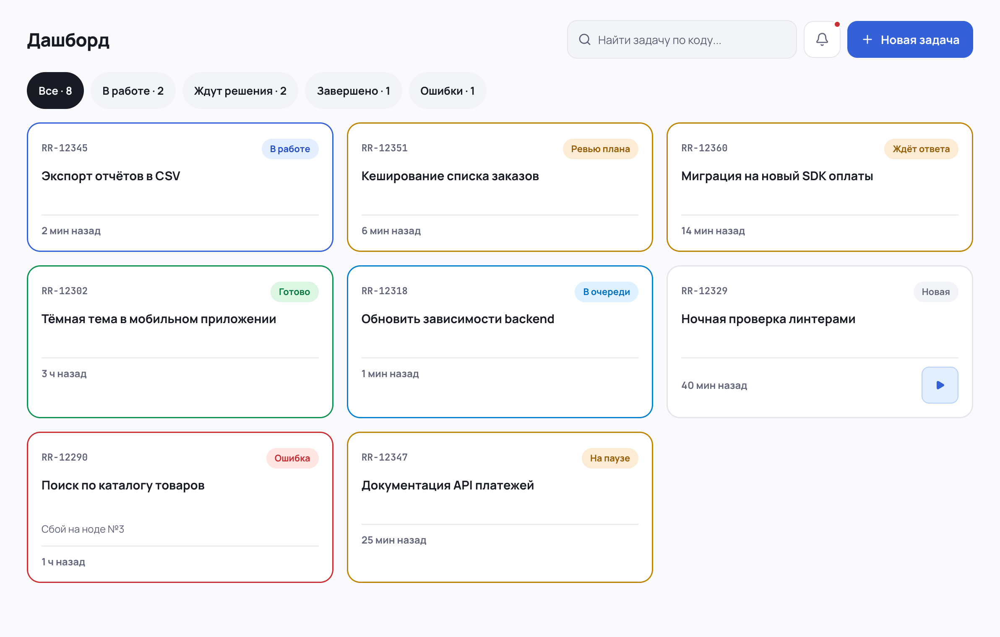
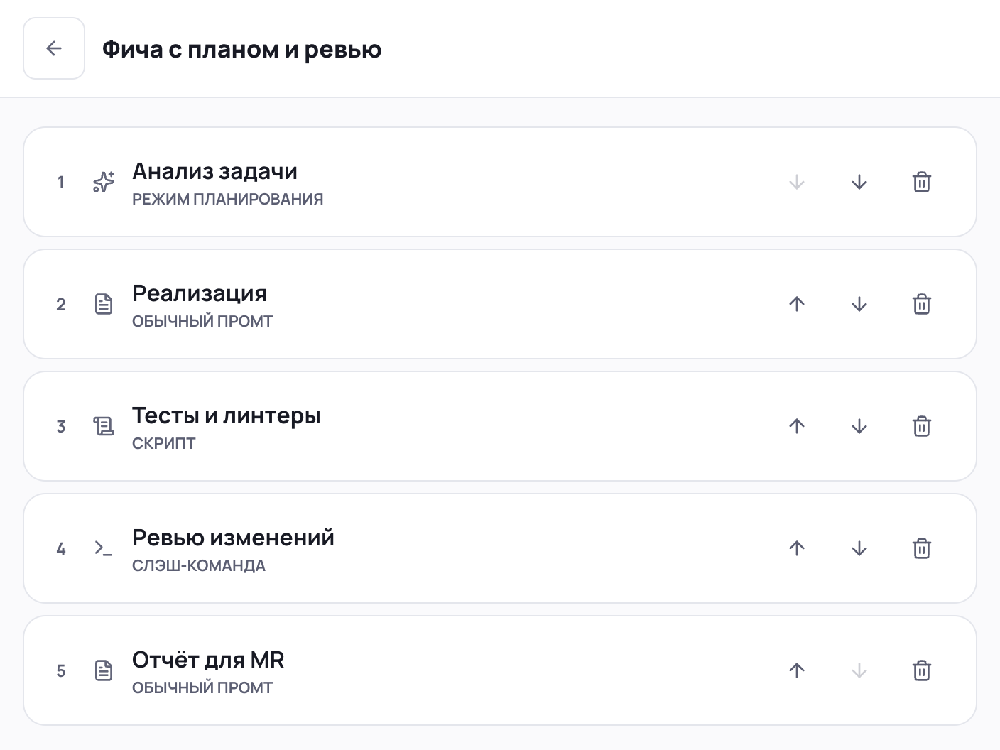
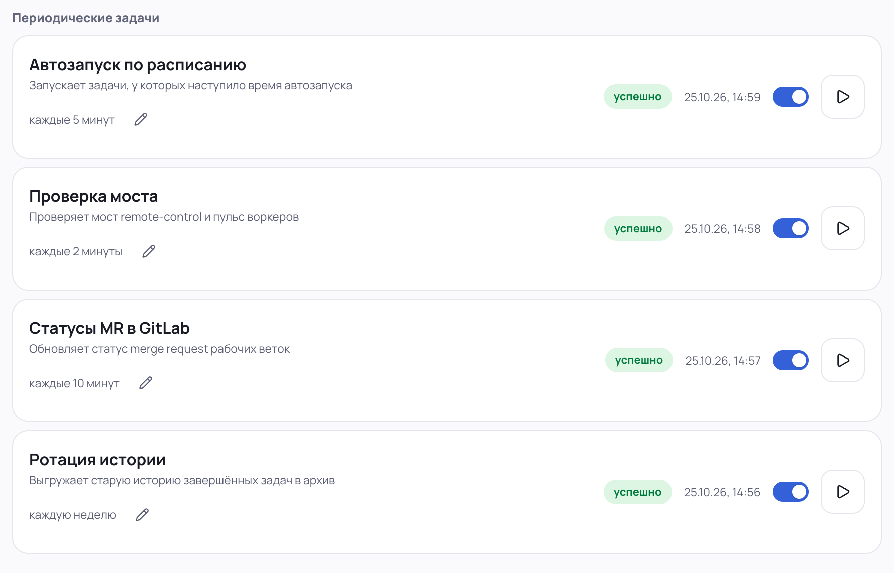
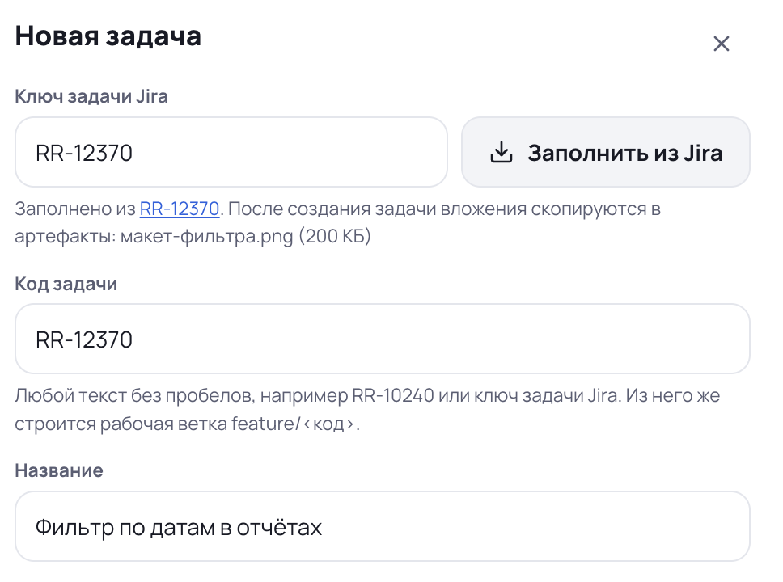
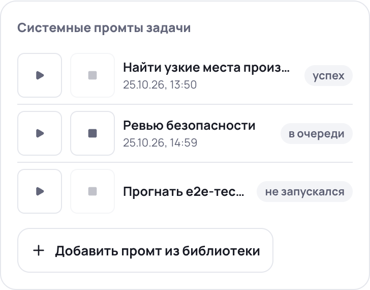
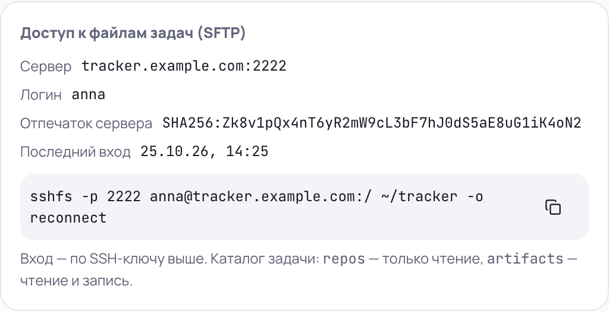
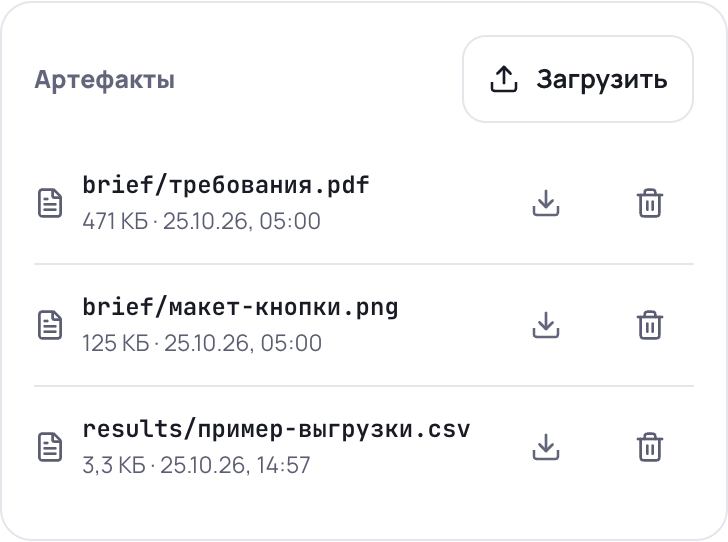

# 🤖 Tracker — AI-трекер задач на базе Claude Code

Tracker — веб-приложение, в котором задачи разработки выполняет AI-агент [Claude Code](https://github.com/anthropics/claude-code). Вы описываете задачу, подключаете репозитории и выбираете пайплайн шагов. Агент проходит шаги сам, а вы следите за ходом работы и отвечаете на его вопросы.

Подробные требования — в [техническом задании](docs/technical_specification.md). Лицензия — [MIT](LICENSE).

<p align="center">
  
</p>

---

## ✨ Что умеет трекер

- 🧩 **Пайплайны из пяти типов шагов:** промт, слэш-команда, скрипт, очистка контекста и режим планирования. Ответ одного шага передаётся в следующий через переменные вида `{{node.llm_output}}`.
- 🗓 **Запуск вручную или по расписанию.** Включите автозапуск и укажите время — задача стартует сама.
- 📝 **Режим планирования.** Агент сначала составляет план, а вы выбираете, что дальше: принять и продолжить автоматически, принять и подтверждать каждое действие или отправить на доработку.
- 💬 **Одна сессия на задачу.** Контекст Claude Code сохраняется между всеми шагами, промтами из библиотеки и вашими сообщениями. Сессию можно смотреть в [claude.ai/code](https://claude.ai/code).
- 📚 **Библиотека промтов.** Готовые промты запускаются в любой момент. Если агент занят, запрос встаёт в очередь и выполнится, как только сессия освободится.
- ❓ **Вопросы агента.** Когда агенту нужно уточнение, задача ждёт вашего ответа. Варианты ответа показываются кнопками.
- 📎 **Артефакты.** Файлы задачи доступны агенту, скриптам, в интерфейсе и по SFTP — папку задач можно подключить как диск.
- 🧪 **MCP-инструменты.** К сессии подключаются [MCP-серверы](https://modelcontextprotocol.io), например [Playwright MCP](https://github.com/microsoft/playwright-mcp). У серверов с состоянием — свой профиль на каждую задачу.
- 📥 **Импорт из Jira.** Код, название, описание и вложения задачи переносятся по её ключу.
- 🔔 **Уведомления.** Статус обновляется в открытой вкладке сразу, а важные события приходят push-уведомлениями.
- 🛡 **Администрирование.** Пользователи, системные настройки, MCP-серверы, расписание фоновых задач и журнал событий.
- 🔐 **Изоляция.** Скрипты работают в контейнере без сети, агент — в отдельном контейнере, секреты хранятся зашифрованными.

---

## 🧭 Как это работает

### Путь задачи

1. **Создание.** Укажите код и название задачи, выберите репозитории, пайплайн и LLM-аккаунт. Отключите шаги, которые в этой задаче не нужны.
2. **Запуск.** Нажмите «Запустить» или дождитесь автозапуска. Задача встаёт в очередь и попадает к свободному воркеру.
3. **Работа агента.** Воркер клонирует репозитории в ветку `feature/<код задачи>`, открывает сессию Claude Code и выполняет шаги по порядку. Ответы агента показываются в ленте по мере генерации.
4. **Решения.** Если агент задал вопрос или составил план, задача ждёт вас — на дашборде она отмечена, а в меню виден счётчик.
5. **Результат.** После последнего шага изменения запушены в рабочие ветки, задача переходит в статус «Выполнено». Проверьте результат и очистите рабочую директорию вручную.

<table>
  <tr>
    <td width="50%" valign="top"></td>
    <td width="50%" valign="top"></td>
  </tr>
  <tr>
    <td align="center"><sub>Ревью плана — три варианта решения</sub></td>
    <td align="center"><sub>Вопрос агента — варианты или свой ответ</sub></td>
  </tr>
</table>

### Статусы задачи

| Статус | Что происходит |
|---|---|
| 🆕 `new` | Задача создана. Можно менять поля, пайплайн и состав шагов |
| ⏳ `queued` | Ждёт свободного воркера. Постановку можно отменить |
| ⚙️ `in_progress` | Агент работает |
| ⏸ `paused` | Пауза после текущего шага, сессия сохранена |
| 📝 `plan_review` | Агент составил план и ждёт решения |
| ❓ `awaiting_input` | Агент ждёт ответа на вопрос |
| 🔀 `rebase_conflict` | Агент разрешает конфликт ребейза на обновлённую базовую ветку |
| ❌ `failed` | Шаг упал после всех повторов или задачу остановили. Можно перезапустить с текущего шага |
| ✅ `done` | Пайплайн пройден, изменения запушены |

Из `failed` и `done` задачу можно «Вернуть в новые» — сменить пайплайн и пройти его заново.

<p align="center">
  <br>
  <sub>Дашборд: фильтры по статусам, цвет рамки карточки — статус задачи</sub>
</p>

### Типы шагов

| Тип | Что делает |
|---|---|
| `plain_prompt` | Отправляет агенту промт. В тексте работают переменные `{{task.*}}`, `{{node.*}}`, `{{env.*}}`, `{{session.id}}` |
| `slash_command` | Передаёт слэш-команду из `.claude/commands/` как есть, без подстановки переменных |
| `script` | Запускает скрипт на Python или Bash в контейнере без сети. Вывод доступен следующим шагам |
| `clear_context` | Завершает сессию и открывает новую с чистым контекстом |
| `plan_prompt` | Переводит агента в режим планирования: он изучает код, но ничего не меняет |

Если шаг пайплайна упал, он повторяется с растущей задержкой. Запуски из библиотеки не повторяются автоматически.

<p align="center">
  <br>
  <sub>Пайплайн из пяти шагов: порядок меняется стрелками, шаг открывается по клику</sub>
</p>

### Компоненты

```
Браузер ──► Caddy (TLS) ──► frontend (React SPA)
                       └──► backend (FastAPI, REST + WebSocket)
                                 │
              ┌──────────────────┼───────────────────┐
              ▼                  ▼                   ▼
         PostgreSQL            Redis           Celery Beat
                                 │            (расписание из БД)
                   ┌─────────────┴─────────────┐
                   ▼                           ▼
           worker (очередь celery)    session-worker (очередь sessions)
           фоновые задачи                     │
                                ┌─────────────┼─────────────────┐
                                ▼             ▼                 ▼
                        tracker-session   tracker-runner-*     git
                        (Claude Code CLI) (скрипты, без сети)

sftp — SFTP-шлюз к файлам задач (порт 2222)
backup — резервные копии PostgreSQL по расписанию
```

- **backend** — HTTP- и WebSocket-API, бизнес-логика, миграции при старте.
- **session-worker** — владеет сессиями задач. Число процессов (`SESSION_WORKER_CONCURRENCY`) — сколько задач выполняется одновременно, остальные ждут в очереди.
- **worker** — 14 периодических задач: автозапуск, проверка моста, синхронизация с GitLab, напоминания, уборка контейнеров, ротация логов и другие.
- **beat** — читает расписание из таблицы `periodic_tasks`. Расписание меняется в админке без перезапуска.
- **tracker-session** — одноразовый контейнер, в котором работает Claude Code CLI задачи.
- **tracker-runner-python / tracker-runner-bash** — контейнеры для script-шагов.

---

## 🛠 Технологии

| Слой | Что используется |
|---|---|
| Backend | Python 3.12, [FastAPI](https://fastapi.tiangolo.com), [SQLAlchemy 2](https://docs.sqlalchemy.org) (async), [Alembic](https://alembic.sqlalchemy.org), [Celery](https://docs.celeryq.dev), [Redis](https://redis.io), [structlog](https://www.structlog.org) |
| Агент | [Claude Agent SDK для Python](https://github.com/anthropics/claude-agent-sdk-python) (`ClaudeSDKClient`) |
| Frontend | [React 19](https://react.dev), [Vite](https://vite.dev), [TanStack Query](https://tanstack.com/query), [Tailwind CSS](https://tailwindcss.com), [shadcn/ui](https://ui.shadcn.com), [TypeScript](https://www.typescriptlang.org) |
| База данных | [PostgreSQL](https://www.postgresql.org) 15+ |
| Инфраструктура | [Docker](https://docs.docker.com), [Docker Compose](https://docs.docker.com/compose/), [Caddy](https://caddyserver.com) |

Точные версии — в [`backend/pyproject.toml`](backend/pyproject.toml) и [`frontend/package.json`](frontend/package.json).

---

## 🚀 Установка на сервер

### Что понадобится

- 🖥 Сервер на Linux с доступом в интернет. [Docker Engine](https://docs.docker.com/engine/install/) 26 или новее — если Docker нет, скрипт поставит его сам.
- 🌐 Домен, направленный на сервер. Порты 80 и 443 должны быть открыты — Caddy [сам выпустит TLS-сертификат](https://caddyserver.com/docs/automatic-https).
- 🔑 OAuth-клиент Google (тип «Web application») — создаётся в [Google Cloud Console](https://console.cloud.google.com/apis/credentials), [инструкция](https://developers.google.com/identity/gsi/web/guides/get-google-api-clientid). В Authorized JavaScript origins добавьте `https://<ваш домен>`.
- 📧 Email первого администратора — тот Google-аккаунт, которым вы будете входить.

### Запуск установщика

Скачайте и запустите [скрипт](deploy/install.sh) от root или через `sudo`:

```bash
curl -fsSL https://raw.githubusercontent.com/the-lans/tracker/main/deploy/install.sh -o install.sh
sudo bash install.sh
```

Скрипт задаст пять вопросов: домен, email для TLS-сертификата, Client ID и Client Secret Google, email администратора. Остальное он сделает сам:

1. Проверит и при необходимости установит Docker.
2. Склонирует репозиторий в `/opt/tracker` (каталог меняется переменной `INSTALL_DIR`).
3. Создаст `.env` и сгенерирует все пароли и ключи.
4. Соберёт образы backend, frontend, раннеров и `tracker-session`.
5. Поднимет PostgreSQL и Redis, применит миграции.
6. Добавит ваш email в список разрешённых и заполнит расписание фоновых задач.
7. Запустит все сервисы.

### После установки

1. 🔓 **Войдите** на `https://<ваш домен>` через Google. Первый пользователь становится администратором.
2. 🧱 **Откройте порт SFTP** в файрволе (по умолчанию 2222), если нужен доступ к файлам задач.
3. 🤖 **Подключите Claude.** Пользователь заводит LLM-аккаунт с каталогом внутри `/data/claude-accounts`, а администратор входит в Claude в этом каталоге:

   ```bash
   cd /opt/tracker
   docker compose exec -e CLAUDE_CONFIG_DIR=/data/claude-accounts/<каталог> worker claude auth login
   docker compose exec -e CLAUDE_CONFIG_DIR=/data/claude-accounts/<каталог> worker claude auth status
   ```

4. ⚙️ **Настройте интеграции** в «Администрирование → Системные настройки»: адрес и [токен GitLab](https://docs.gitlab.com/user/profile/personal_access_tokens/) — для статусов merge request, адрес Jira — для импорта задач. Личный [API-токен Jira](https://id.atlassian.com/manage-profile/security/api-tokens) каждый пользователь указывает в своём профиле.

---

## 🔄 Обновление, перенос и резервные копии

**Обновление до свежей версии:**

```bash
sudo /opt/tracker/deploy/install.sh --update
```

[Скрипт](deploy/install.sh) подтянет код (только перемоткой вперёд — локальные правки на сервере не затрутся), пересоберёт все образы, применит миграции и перезапустит сервисы. Задачи, которые выполнялись в этот момент, перейдут в `failed` — продолжите их кнопкой «Перезапустить с текущей ноды».

**Перенос на новый сервер:**

```bash
sudo bash install.sh --restore <каталог с архивами>
```

В каталоге должны лежать `.env`, дамп базы `*.sql.gz` и архивы volume: `task_repos`, `user_files`, `log_archive`, `claude_accounts`, `sftp_host_keys`. Как их снять со старого сервера — в [docs/migration.md](docs/migration.md).

**Резервные копии.** Сервис [`backup`](deploy/backup/) каждый день снимает дамп PostgreSQL. Расписание и срок хранения задаются в `.env`: `POSTGRES_BACKUP_CRON` и `POSTGRES_BACKUP_RETENTION_DAYS`.

---

## ⚙️ Конфигурация

Все настройки сервера — в файле `.env`. Шаблон с комментариями — [`.env.example`](.env.example), описание сервисов — [`docker-compose.yml`](docker-compose.yml) и [`docker-compose.prod.yml`](docker-compose.prod.yml). Пароли и ключи установщик генерирует сам, вручную их задавать не нужно.

| Переменная | Назначение | По умолчанию |
|---|---|---|
| `DOMAIN`, `ACME_EMAIL` | Домен трекера и email для TLS-сертификата | — |
| `GOOGLE_OAUTH_CLIENT_ID`, `GOOGLE_OAUTH_CLIENT_SECRET` | Вход через Google | — |
| `SECRET_ENCRYPTION_KEY` | Ключ шифрования секретов в БД. Без него зашифрованные данные не прочитать — храните `.env` в надёжном месте | генерируется |
| `SESSION_SECRET_KEY` | Подпись токенов входа | генерируется |
| `VAPID_PUBLIC_KEY`, `VAPID_PRIVATE_KEY` | Ключи push-уведомлений | генерируются |
| `SESSION_WORKER_CONCURRENCY` | Сколько задач выполняется одновременно | `4` |
| `CLAUDE_SESSION_RETENTION_DAYS` | Сколько дней Claude Code хранит историю сессий | `36500` |
| `SFTP_PORT` | Порт SFTP-шлюза на хосте | `2222` |
| `ARTIFACT_MAX_UPLOAD_MB` | Максимальный размер загружаемого файла, МБ | `100` |
| `POSTGRES_BACKUP_CRON`, `POSTGRES_BACKUP_RETENTION_DAYS` | Расписание бэкапа и срок хранения в днях | `0 3 * * *`, `14` |

Настройки, которые меняются без перезапуска — образы раннеров, таймауты и повторы шагов, GitLab, Jira, — находятся в админке.

<p align="center">
  <br>
  <sub>Периодические задачи в админке: расписание, включение и ручной запуск</sub>
</p>

---

## 👋 Первые шаги

1. **Заведите LLM-аккаунт** в разделе «LLM-аккаунты» и попросите администратора войти в Claude в его каталоге. Задаче из одних скриптов аккаунт не нужен.
2. **Добавьте репозиторий** в разделе «Репозитории»: адрес `ssh://`, `https://` или `git@host:group/project.git` и deploy-ключ.
3. **Соберите пайплайн** в разделе «Пайплайны». Кнопка предпросмотра покажет, как промт выглядит после подстановки переменных.
4. **Создайте задачу** на дашборде. Код — любой текст без пробелов, например `RR-12345`. Форму можно заполнить из Jira по ключу.
5. **Запустите** и следите за лентой на вкладке «Диалог». Свободный промт можно отправить в любой момент, пока идёт сессия.

<table>
  <tr>
    <td valign="top"></td>
    <td valign="top"></td>
  </tr>
  <tr>
    <td align="center"><sub>Новая задача, заполненная из Jira</sub></td>
    <td align="center"><sub>Промты из библиотеки: ▶ — запуск, ■ — отмена</sub></td>
  </tr>
</table>

### 📂 Файлы задач по SFTP

Администратор назначает вам логин SFTP в разделе «Пользователи», а вы добавляете публичный SSH-ключ в профиле. Там же — отпечаток ключа сервера и готовая команда. Подключение как диска через [sshfs](https://github.com/libfuse/sshfs) (на Windows — [SSHFS-Win](https://github.com/winfsp/sshfs-win), на macOS и Windows подойдёт и [Mountain Duck](https://mountainduck.io)):

```bash
sshfs -p 2222 <логин>@<домен>:/ ~/tracker -o reconnect
```

В каждой задаче две папки: `repos` — репозитории, только чтение; `artifacts` — файлы задачи, чтение и запись.

<table>
  <tr>
    <td valign="top"></td>
    <td valign="top"></td>
  </tr>
  <tr>
    <td align="center"><sub>Подключение по SFTP в профиле</sub></td>
    <td align="center"><sub>Те же файлы — в карточке «Артефакты»</sub></td>
  </tr>
</table>

---

## 👩‍💻 Разработка

### Что нужно

Python 3.12+, Node.js 22+, Docker.

### Установка зависимостей

```bash
# backend
cd backend && python3.12 -m venv .venv && source .venv/bin/activate
pip install -e ".[dev]"

# frontend
cd frontend && npm install
```

### Локальный запуск

```bash
# весь стек в Docker
docker compose up -d

# или по отдельности
cd backend && uvicorn main:app --reload
cd backend && celery -A tasks.celery_app worker -Q celery -l info
cd backend && celery -A tasks.celery_app worker -Q sessions -O fair -l info
cd backend && celery -A tasks.celery_app beat -l info
cd frontend && npm run dev
```

Образы раннеров и контейнера сессии в `docker-compose.yml` не входят — соберите их отдельно и пересобирайте после правок в [`runners/`](runners/):

```bash
docker build -t tracker-runner-python:latest runners/tracker-runner-python/
docker build -t tracker-runner-bash:latest runners/tracker-runner-bash/
docker build -t tracker-session:latest runners/tracker-session/
```

### ✅ Проверки

```bash
make check
```

Команда из [`Makefile`](Makefile) по очереди запускает `ruff`, `mypy` и `pytest` для backend, затем `eslint` и `tsc --noEmit` для frontend. Она падает на первой ошибке, а также если покрытие `backend/services/` тестами ниже 85%.

Тестам backend нужен запущенный Docker: тестовые PostgreSQL (порт 55432) и Redis (порт 55379) поднимаются автоматически. Тесты script-шагов используют образы раннеров — их нужно собрать заранее.

В CI ([`.github/workflows/ci.yml`](.github/workflows/ci.yml)) перед `make check` собираются образы раннеров, а после — проверяется продовый образ фронтенда ([`scripts/smoke_frontend_image.sh`](scripts/smoke_frontend_image.sh)). Обновления зависимостей еженедельно предлагает [Dependabot](.github/dependabot.yml).

### Миграции

```bash
cd backend && alembic revision --autogenerate -m "описание изменения"
cd backend && alembic upgrade head
```

В продакшене миграции применяются автоматически при старте контейнера. Пишите DDL с `IF [NOT] EXISTS`, чтобы повторный запуск не падал.

### Правила для участников

Соглашения по коду, именованию и критичные правила проекта собраны в [CLAUDE.md](CLAUDE.md). Коммиты — в формате [Conventional Commits](https://www.conventionalcommits.org/ru/): `feat:`, `fix:`, `docs:`, `test:`, `refactor:`, `chore:`, `ci:`.

---

## 🗂 Структура репозитория

```
backend/        FastAPI-приложение
  api/            HTTP-эндпоинты и схемы
  services/       бизнес-логика: пайплайны, сессии, git, доступ
  db/             ORM-модели и подключение к БД
  clients/        обёртки над Claude Agent SDK, GitLab и Jira
  tasks/          Celery: воркер сессий и периодические задачи
  ws/             WebSocket-канал статуса задачи
  sftp_gateway/   SFTP-шлюз
  tests/          тесты pytest
frontend/       React SPA
alembic/        миграции базы данных
runners/        образы раннеров скриптов и контейнера сессии
deploy/         установщик, конфигурация Caddy, сервис бэкапов
scripts/        начальное заполнение данных и служебные проверки
docs/           ТЗ, план реализации, инструкция по переносу
```

---

## 🔐 Безопасность

- **Вход** — только через Google и только для email из списка разрешённых. Администратор управляет списком в админке.
- **Роли.** Пользователь видит только свои задачи, пайплайны, промты, шаблоны и LLM-аккаунты. Администратор — все записи, настройки и мониторинг.
- **Секреты** — deploy-ключи, секретные переменные, токены GitLab и Jira — хранятся в БД зашифрованными. В предпросмотре и в истории промтов они замаскированы.
- **Скрипты** выполняются в контейнере без сети, с лимитами CPU и памяти. Им доступны только репозитории и артефакты своей задачи.
- **Агент** работает в отдельном контейнере `tracker-session`: без доступа к Docker, внутренней сети сервисов и ключам шифрования.
- **Git** воркера не исполняет код из репозитория: хуки отключены, глобальный конфиг не читается.
- **SFTP** — только по SSH-ключу, без shell и проброса портов. Шлюз подключается к БД ролью с минимальными правами.

---

## 📖 Документация

- [Техническое задание](docs/technical_specification.md) — полные требования к продукту.
- [План реализации](docs/implementation_plan.md) — этапы и принятые решения.
- [Перенос на новый сервер](docs/migration.md) — пошаговая процедура.
- [Проверка моста remote-control](docs/remote_control_findings.md) — как трекер управляет просмотром сессии в `claude.ai/code`.
- [Макеты интерфейса](docs/design/) и [скриншоты страницы задачи](docs/screen/).
- [CLAUDE.md](CLAUDE.md) — руководство для разработки в репозитории.

Внешняя документация:

- [Claude Code](https://github.com/anthropics/claude-code) и [Claude Agent SDK для Python](https://github.com/anthropics/claude-agent-sdk-python).
- [Model Context Protocol](https://modelcontextprotocol.io) — протокол MCP-серверов.

---

## 📄 Лицензия

[MIT](LICENSE)
